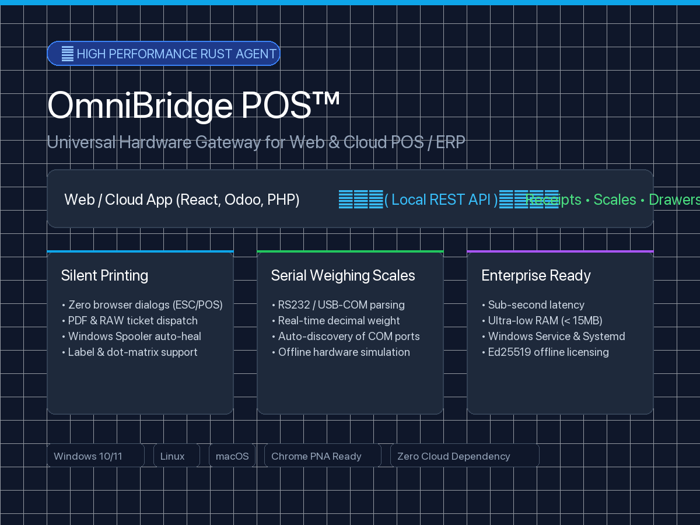

# OmniBridge POS™ — Universal Hardware Gateway (Rust)
### Evaluation DEMO & Integration Documentation

**English** | [Español](README.es.md)

[](https://www.rust-lang.org/)
[]()
[](https://github.com/dpadrino/omnibridge-pos-demo/releases)
[](https://github.com/dpadrino/omnibridge-pos-demo/releases)
[](https://github.com/dpadrino/omnibridge-pos-demo/stargazers)
[](https://dpadrino.github.io/omnibridge-pos-demo/)
[](https://dpadrino.github.io/omnibridge-pos-demo/#video-section)
[](LICENSE.txt)

[](https://dpadrino.github.io/omnibridge-pos-demo/)

> ### 🌐 [TEST INTERACTIVE DEMO & WATCH VIDEO ONLINE (CLICK HERE)](https://dpadrino.github.io/omnibridge-pos-demo/)
> 💡 **Navigation Notice:** When browsing repository files inside GitHub, `.html` files are displayed as raw source code due to platform security policies. To explore the **Silent Thermal Printer Simulator**, the **Digital Weighing Scale**, and watch the **Voiceover Video Demo**, visit the live hosted web page directly:  
> 👉 **[https://dpadrino.github.io/omnibridge-pos-demo/](https://dpadrino.github.io/omnibridge-pos-demo/)**
> 
> 📄 **[Download Official Commercial Brochure (PDF)](docs/OmniBridge_POS_Brochure_Comercial.en.pdf)**

---

## 1. What is OmniBridge POS™?

Modern web browsers enforce strict security sandbox policies that prevent direct access to local hardware. As a result:
* Printing thermal receipts forces an intrusive print dialog window (`Ctrl+P`).
* Web applications cannot directly communicate with RS232 / USB-Serial weighing scales.
* Cash drawers connected via RJ11/RJ12 cannot be triggered without OS driver friction.

**OmniBridge POS™** is a high-performance, native background service written in **Rust** that bridges any Web or Cloud POS/ERP (React, Angular, Vue, PHP, Laravel, Odoo, WooCommerce) to physical checkout devices via simple local HTTP REST calls.

---

## 2. 🎬 Video Demo & Interactive Visual Guide

Experience the product in action and explore the hardware workflow before deploying it to your checkout stations:

| Resource | Description | Direct Access |
| :--- | :--- | :--- |
| 🌐 **Interactive Visual Showcase** | Interactive HTML5 playground: simulate silent thermal printing, live scale readings, and cash drawer kick directly in your browser without installing anything. | 🚀 [**Launch Live Showcase (GitHub Pages)**](https://dpadrino.github.io/omnibridge-pos-demo/) |
| 🎬 **Video Demo with Voiceover** | 1-minute Full HD video walkthrough with human voiceover explaining the browser popup problem and how OmniBridge POS resolves it with sub-second silent printing. | ▶️ [**Watch Video Online**](https://dpadrino.github.io/omnibridge-pos-demo/#video-section) <br> 📥 [Download Direct MP4 (1.8 MB)](https://github.com/dpadrino/omnibridge-pos-demo/releases/download/v1.2.0/OmniBridge_POS_Promo_Video.mp4) |
| 📄 **Commercial Brochure (PDF)** | Comprehensive 2-page executive summary with technical specs, REST architecture, and pricing. | 📥 [**Download PDF Brochure**](docs/OmniBridge_POS_Brochure_Comercial.en.pdf) |

---

## 3. ⚡ Quick Download & Evaluation DEMO

[](https://github.com/dpadrino/omnibridge-pos-demo/releases)
[](https://github.com/dpadrino/omnibridge-pos-demo/releases)
[](https://tofrontend.com/github-release-stats/?username=dpadrino&repository=omnibridge-pos-demo)

You can download the pre-compiled evaluation package directly from the GitHub Releases page:

👉 **[Download Latest Evaluation DEMO (v1.2.0)](https://github.com/dpadrino/omnibridge-pos-demo/releases)**

### Free Evaluation Mode Includes:
* **Full access to all REST endpoints** on port `8989`.
* **Visual Web Dashboard & Host Setup Wizard** at `http://127.0.0.1:8989/`:
  - Live auto-discovery of COM/serial ports and system printers.
  - Interactive peripheral assignment and host configuration without touching TOML files manually.
  - **In-App License Manager:** Live validity indicator and 1-click license activator (`.key` file or text paste) with Ed25519 cryptographic validation.
* **Serial scale reading:** Direct real hardware connection or simulation mode for offline dev.
* **Silent thermal printing:** Receipts, labels, and matrices with **DEMO watermark** (`*** MODO DEMO - OMNIBRIDGE POS ***`) and courtesy daily quota.
* **Automatic Windows Spooler queue healing:** Recovers stuck jobs seamlessly.

---

## 4. 🛠️ Installation Instructions by Operating System

OmniBridge POS is distributed as a single native pre-compiled **Rust** executable (< 5 MB) with automated scripts for every platform:

| Operating System | Download Package | Quick Installation | Detailed Guide |
| :--- | :--- | :--- | :--- |
| 🪟 **Windows 10 / 11 / Server** | `omnibridge-pos-windows-x86_64.zip` | Extract to `C:\PosAgent` and run `powershell -ExecutionPolicy Bypass -File .\scripts\install_windows_service.ps1` as Administrator. | 📘 [Windows Deployment Guide](docs/DEPLOYMENT_GUIDE.md#31-producci%C3%B3n-en-windows-pcs-facturadoras-de-tienda) |
| 🐧 **Linux (Ubuntu / Debian / RHEL)** | `omnibridge-pos-linux-x86_64.tar.gz` | Extract, grant serial port permissions (`sudo usermod -aG dialout $USER`), and run `./scripts/run_macos_linux.sh` or register `systemd` service. | 📘 [Linux Deployment Guide](docs/DEPLOYMENT_GUIDE.md#32-producci%C3%B3n-en-linux-servidor-o-caja-con-systemd) |
| 🍎 **macOS (Apple Silicon & Intel)** | `omnibridge-pos-macos-arm64.tar.gz` | Extract, clear Gatekeeper (`xattr -cr .`), and run `./scripts/run_macos_linux.sh` or register `launchd` daemon. | 📘 [macOS Deployment Guide](docs/DEPLOYMENT_GUIDE.md#22-en-macos-desarrollo-y-paquete-precompilado) |

> 📖 **[Open Master Deployment & Technical Installation Guide (DEPLOYMENT_GUIDE.md)](docs/DEPLOYMENT_GUIDE.md)**  
> 🌐 **[Open Interactive Visual Showcase on the Web](https://dpadrino.github.io/omnibridge-pos-demo/#installation-section)**

---

## 5. Integration in 3 Lines of Code (JavaScript)

```javascript
// 1. Read weight in real-time from the serial scale:
const { peso } = await (await fetch('http://localhost:8989/peso')).json();

// 2. Trigger the electric cash drawer kick-out pulse:
await fetch('http://localhost:8989/drawer', { method: 'POST' });

// 3. Print a silent thermal receipt instantly (sub-second):
await fetch('http://localhost:8989/ticket', {
  method: 'POST',
  headers: { 'Content-Type': 'application/json' },
  body: JSON.stringify({ content: "ORDER #101\nTotal: $25.00\nTHANK YOU FOR YOUR PURCHASE\n" })
});
```

---

## 6. Core API Endpoints (Unified Port 8989)

| Method | Endpoint | Description | Payload Format |
| :--- | :--- | :--- | :--- |
| `GET` | `/` | Visual Diagnostic Web Dashboard & Setup Wizard | HTML |
| `GET` | `/peso`, `/weight` | Real-time weight from RS232 / USB serial scale | JSON `{"peso": 1.25, "unit": "kg"}` |
| `POST`| `/ticket` | Intelligent silent thermal receipt printing | JSON, Multipart PDF, or RAW |
| `POST`| `/drawer`, `/gaveta` | Trigger physical cash drawer pulse (RJ11 Pin 2 & 5) | Empty POST |
| `POST`| `/print-label` | Direct RAW barcode label dispatch (TSPL / ZPL) | JSON `{"commands": "..."}` |
| `POST`| `/print-matrix`| Continuous feed / dot-matrix text printing (ESC/P) | JSON `{"text": "...", "form_feed": true}` |
| `POST`| `/print/document`| Full-page Office Laser / A4 document printing (`fit`) | Multipart PDF or JSON URL |
| `GET` | `/printers` | Hardware catalog with 4-way classification heuristics | JSON Printers Catalog |
| `POST`| `/printers/cleanup` | Auto-purge and recover jammed Windows Print Spooler queues | Empty POST |
| `GET/POST`| `/api/v1/config` | Query and live-save host variables atomically | JSON Config Payload |
| `GET/POST`| `/api/v1/license`| Query validity status and hot-activate license key | JSON License Status |
| `GET` | `/health`, `/status` | Complete health check across ports, spooler, and license | JSON Health Status |
| `GET` | `/biometric/health` | Biometric hardware connectivity and status | JSON Biometric Status |
| `POST`| `/biometric/enroll` | Employee fingerprint enrollment | JSON Template |
| `GET` | `/biometric/logs` | Time attendance punch records with date filtering | JSON Attendance Logs |
| `POST`| `/biometric/push` | Real-time push punch receiver (ZKTeco ADMS / JSON) | Text/JSON |

---

## 7. Commercial Licensing & Pricing

When you are ready to remove evaluation quotas and watermarks, upgrade to a commercial license verified offline via **Ed25519 digital signatures**:

| Plan | Target Audience | Pricing | Direct WhatsApp Purchase | What's Included |
| :--- | :--- | :--- | :--- | :--- |
| **Station Annual** | Retail stores, supermarkets, pharmacies | **$35 USD** / yr | [🛒 Buy ($35)](https://wa.me/584126165227?text=Hello%20Darwin,%20I%20want%20to%20buy%20the%20Annual%20Station%20License%20($35%20USD)) | 1-Click Windows Service installer, unlimited receipts and scale readings, zero watermarks, and live host configuration wizard. |
| **Station Lifetime** | Fixed single checkout stations | **$90 USD** (One-time fee) | [🛒 Buy ($90)](https://wa.me/584126165227?text=Hello%20Darwin,%20I%20want%20to%20buy%20the%20Lifetime%20Station%20License%20($90%20USD)) | Lifetime perpetual license, Ed25519 offline digital signature, spooler auto-purge, and maintenance updates. |
| **OEM / White-Label** | Software houses, Cloud POS / ERP SaaS | **$390 USD** (One-time fee) | [🛒 Buy OEM ($390)](https://wa.me/584126165227?text=Hello%20Darwin,%20I%20want%20to%20buy%20the%20OEM%20White-Label%20License%20($390%20USD)) | Unlimited distribution under your brand and logo, zero per-seat royalties, full Postman collection, OpenAPI 3.0 spec, and keygen tool. |
| **Custom Engineering** | Bespoke corporate integrations | **Project Quote** | [💬 Request Quote](https://wa.me/584126165227?text=Hello%20Darwin,%20I%20want%20a%20custom%20engineering%20quote%20for%20OmniBridge%20POS) | Industrial scale protocols, custom drivers, and assisted integration with Odoo, WooCommerce, or custom backends. |

---

## 8. Official Commercial Brochures (PDF)

* 🇪🇸 [**Download Official Brochure (Español PDF)**](docs/OmniBridge_POS_Brochure_Comercial.es.pdf)
* 🇺🇸 [**Download Official Brochure (English PDF)**](docs/OmniBridge_POS_Brochure_Comercial.en.pdf)

---

## 9. Community & Project Traction

If you find this project useful or interesting, please consider giving it a ⭐ **Star** on GitHub to help others discover it!

* 💡 **Feature Requests & Feedback:** Open an issue on [GitHub Issues](https://github.com/dpadrino/omnibridge-pos-demo/issues).
* 📊 **Real-time Download Metrics:** Inspect live asset statistics on [GitHub Release Stats](https://tofrontend.com/github-release-stats/?username=dpadrino&repository=omnibridge-pos-demo) or star growth on [Star History](https://star-history.com/#dpadrino/omnibridge-pos-demo).

---

## 10. Developer & Sales Contact

For commercial inquiries, license purchases, or custom driver support:

* **Lead Developer:** Darwin Padrino
* **WhatsApp / Phone:** [+58 412-6165227](https://wa.me/584126165227)
* **Email:** [drinowar@gmail.com](mailto:drinowar@gmail.com)
* **Location:** Caracas, Venezuela (Available Worldwide for Remote Integration)
